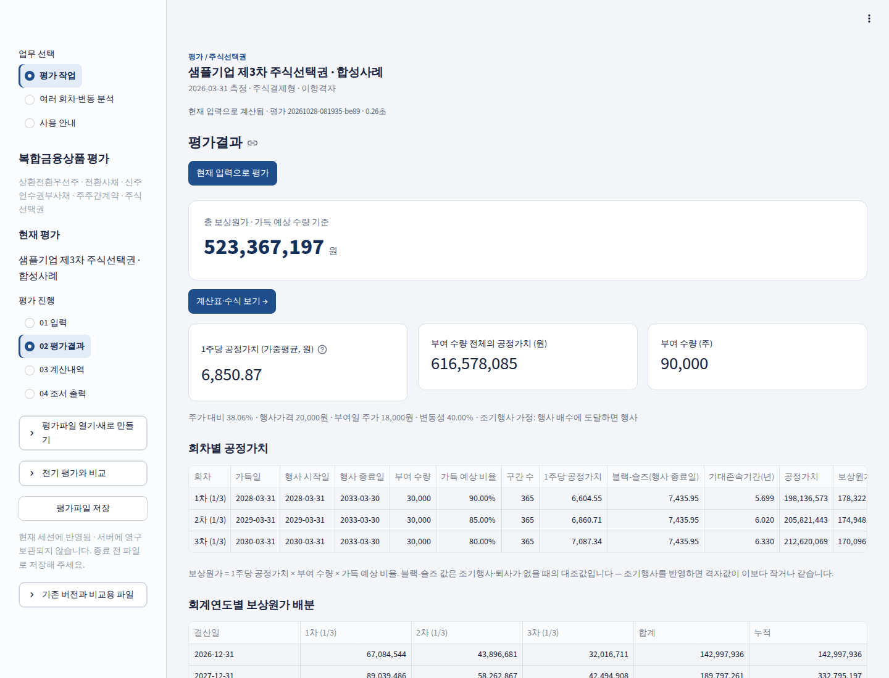

# 복합금융상품 평가 앱 사용 안내

이 안내만 보고 처음 화면에서 엑셀 조서까지 혼자 진행할 수 있도록 순서대로 적었습니다. 그림은 «합성사례»(가상의 숫자) 화면입니다. 실제 고객 자료로 연습하지 마십시오.

화면에서 누르는 단추와 고르는 항목은 «이렇게» 표시했습니다. 화면의 글자와 같습니다.

## 1. 화면 구성 한눈에 보기

- **왼쪽 위 «업무 선택»**: «평가 작업»(한 건을 평가), «여러 회차·변동 분석»(여러 회차 합산, 전기 대비 변동), «사용 안내»(이 안내)
- **«평가파일 열기·새로 만들기»**: 평가를 시작하거나 저장해 둔 파일을 엽니다.
- **«평가 진행»**: 평가를 열면 네 단계가 보입니다. 위에서 아래로 진행합니다.
  1. «01  입력» — 계약조건·주가·변동성·금리와 출처
  2. «02  평가결과» — 평가 실행과 결과 확인
  3. «03  계산내역» — 노드 계산표 등 계산 근거
  4. «04  조서 출력» — 엑셀 조서 만들기
- **«평가파일 저장»**: 지금까지 입력을 내 컴퓨터에 저장합니다. 앱은 서버에 보관하지 않으므로 끝내기 전에 꼭 저장하십시오.

꼭 기억할 두 가지:

- 입력을 바꿔도 결과는 저절로 바뀌지 않습니다. «02  평가결과»에서 «현재 입력으로 평가»를 눌러야 계산합니다.
- 조서는 마지막으로 평가한 결과로만 만듭니다. 입력을 바꿨다면 다시 평가한 뒤 조서를 만드십시오.

## 2. 평가 시작하기

왼쪽 «평가파일 열기·새로 만들기»를 펼치면 다섯 가지 길이 있습니다.

1. **처음 써 본다면 — «합성사례로 시작하기»**: 상환전환우선주 예제가 채워진 채로 열립니다. 이 안내의 그림이 이 예제입니다.
2. **새 평가 — «빈 입력안 만들기»**: «평가 건명»을 적고 «평가 상품»(상환전환우선주·전환사채·신주인수권부사채·주주간계약·주식선택권)을 고른 뒤 누릅니다.
3. **저장해 둔 평가 이어서 — «평가파일 불러오기»**: 파일 올리기 단추(화면 표시: Upload)를 누르거나 파일을 끌어다 놓습니다. 확장자가 .json 인 평가파일입니다.
4. **실제 공시로 연습 — «공시 사례 열기»**: «공시 사례»에서 고르고 누릅니다. 전자공시에 공개된 전환사채 세 건의 2025년 말 결산 평가와 주식선택권 한 건(라파스 제10차 부여)이 열립니다. «출처·평가가정 → 자료 출처·검토메모»에 공시 접수번호, 회사가 공시한 공정가치, 이 앱 계산값과의 차이를 적어 두었습니다. 공시에 없는 입력값(변동성·할인율 등)은 평가자가 정한 값이라 회사가 실제로 쓴 값과 다를 수 있습니다.

5. **주식선택권을 처음 써 본다면 — «주식선택권 합성사례로 시작하기»**: 3년에 걸쳐 나눠 가득되는 가상 회사의 부여가 열립니다. 자세한 순서는 아래 11장(주식선택권 평가)에 있습니다.

지난 결산 평가를 이번 기준일로 갱신할 때는 왼쪽 «전기 평가와 비교»에 지난 평가파일을 넣고 «전기 입력을 새 평가로 복사»를 누르십시오. 계약조건을 그대로 가져오고, 결과 화면에서 전기 대비 바뀐 입력을 함께 보여 줍니다.

## 3. 01 입력 — 계약조건 넣기

«01  입력»의 «입력 항목»에서 «계약·평가 입력»을 고릅니다. 계약서 순서대로 위에서 아래로 채웁니다. 입력은 바로 저장됩니다.

1. **«평가대상 및 기준일»**: 회차, 평가 관점(발행자·투자자), 실제 발행일, 평가기준일, 계약상 만기일, 발행금액. 큰 금액 아래에는 «60억 원»처럼 읽기 쉬운 숫자가 함께 나옵니다.
2. **이자·만기 상환**(상환전환우선주는 우선배당·만기 상환): 표면이자율·우선배당률, 지급주기, 만기보장수익률.
3. **전환권**(신주인수권부사채는 신주인수권): 현재 전환가액, 행사 시작일·종료일, 행사방식, 전환가액 정기 조정(시가 하락 조정)의 주기·하한.
4. **«상환청구권 (투자자)»**: 상환청구 시작일·종료일, 주기, 상환청구금액 산정(보장수익률 누적 등).
5. **«매도청구권 (콜)»**: «콜 권리 있음»을 켜고 행사기간, 대상 비율, 매매금액 가산율, 의무보유, 통지 뒤 전환 가능 여부, 조기상환과의 우선순위를 넣습니다.
6. 권리마다 바로 아래의 «… 회계 분류»·«… 회계처리» 칸에서 부채·자본 분류와 분리 여부를 고릅니다.
7. **«회계 정책 (공통)»**, **«시장자료 및 계산방법»**: 평가모형, 계산 간격, 금리곡선 등.

- 칸 옆의 물음표에 마우스를 올리면 설명이 나옵니다.
- 날짜 순서가 맞지 않거나 정수 칸에 소수를 넣는 등 맞지 않는 값을 넣으면 그 자리에 빨간 안내가 나옵니다. 안내대로 고치면 사라집니다.
- «정밀값 보기»를 켜면 숫자를 소수 여섯째 자리까지 보여 줍니다. 계산에 쓰는 값은 그대로입니다.
- 상품별 자세한 입력 요령은 저장소의 입력안내 문서(상환전환우선주·신주인수권부사채·주주간계약)에 있습니다.

## 4. 01 입력 — 주가·변동성·금리 자료

«입력 항목»에서 «주가·변동성·금리 자료»를 고르고 «시장자료 도구»에서 필요한 도구를 고릅니다.

- **«변동성 산출»**: 상장사는 «상장사 — 대상회사 주가», 비상장사는 «비상장사 — 피어로 산출»을 고릅니다. 주가는 «야후 파이낸스»로 받거나 «종가 파일»(첫 열 날짜, 다음 열부터 종목별 종가)을 올립니다. «조회 일수 (거래일)»·«연 거래일수»·«이상치 제거 (중앙값 절대편차 2.5배)»를 정한 뒤 «주가 받기» 또는 «파일을 현재 조건으로 읽기»를 누르고, 수치를 확인한 다음 «이 변동성을 현재 평가에 적용»을 누릅니다. 쓴 주가와 조건이 평가파일과 조서에 함께 남습니다.
- **«기준일 주가 조회»**: 종목코드로 평가기준일 종가를 가져옵니다. 휴장일이면 직전 거래일 종가입니다.
- **«주가 역산»**: 발행일 평가에서 평가값이 발행가와 같아지는 주당가치를 찾습니다(최초 인식 보정). 적용하면 보정 기록이 조서에 남습니다.
- **«금리곡선 불러오기»**: 채권평가회사 기준수익률 표(«KIS-Net 파일») 또는 «표 붙여넣기»로 무위험 곡선과 위험 곡선(한 등급, 또는 두 등급 보간)을 넣습니다.

엑셀에서 기준금리를 손으로 고치지 않도록, 금리는 앱에서 넣고 다시 평가하십시오.

## 5. 01 입력 — 출처·평가가정

«입력 항목»에서 «출처·평가가정»을 고릅니다.

- **«자료 출처·검토메모»**: «시장자료 기준일(YYYY-MM-DD)», 주가·변동성·무위험 금리곡선·위험 금리곡선의 출처와 산출근거, 계약서 위치·조항, 검토메모를 적고 «출처·메모 저장»을 누릅니다. 조서의 출처기록에 그대로 실립니다. 비워 두면 조서의 출처 칸도 비어 나갑니다.
- **«평가자 메모 · 선택 기록»**: 전환가액 조정 조항, 분리 판단 등 판단한 내용과 근거를 남깁니다. 메모를 남긴 뒤 관련 입력을 바꾸면, 결과 화면의 확인할 사항에 «이전 조건의 기록 · 재확인 필요»가 나옵니다.
- **«계약조건과 다른 평가가정»**: 계약서 원래 값은 그대로 두고, 계산에만 다른 값을 쓸 때 근거와 함께 기록합니다.

다 넣었으면 «평가결과로 이동 →»을 누릅니다.

## 6. 02 평가결과 — 평가하고 결과 읽기

«현재 입력으로 평가»를 누르면 계산합니다. 보통 몇 초 걸립니다.

- **큰 숫자**: 순포지션 가치(콜 차감 후). «표시 단위»에서 «총액 · 원», «주당 · 원»(상환전환우선주), «원금 100»을 고를 수 있습니다.
- **본체 · 콜 차감 전**, **콜 차감**, **계산 구간**(격자 칸 수와 한 칸의 평균 일수).
- **«평가금액 구성»**: 주계약 → 상환권 증분 → 전환권 증분 → 콜옵션 차감 순서로 권리를 하나씩 더한 차이입니다. 회계상 인식액과는 다릅니다.

- **«확인할 사항 … · 계산 점검»**: 평가자가 확인해야 할 내용과 산술 대사 결과입니다. 노란 안내가 있으면 먼저 읽으십시오.
- **«행사·지급일정»**: 조기상환·매도청구·만기의 날짜별 금액.
- **«민감도 · 기준 평가 유지»**: 주가·변동성·금리를 위아래로 바꾼 값을 «민감도 계산»으로 봅니다. 원래 평가는 그대로 둡니다.
- **«회계 참고 · 선택한 분류 가정»**: 최초 인식 배분, 분리 판단 참고.
- **«상세 계산·회계 참고표 …»**: «분석 도구»에서 «상세 계산·회계 참고표»를 고르면 판단·근거, 상각표, 상세 민감도, 추가 검산을 계산합니다.

입력을 바꾸면 결과 위에 «입력이 변경되었습니다. 아래는 이전 결과입니다» 안내가 나옵니다. 그때는 «현재 입력으로 평가»를 다시 누르십시오.

## 7. 03 계산내역 — 계산 근거 확인

«계산표·수식 보기 →» 또는 왼쪽 «03  계산내역»으로 옵니다.

- **«노드 계산표»**: 격자의 모든 칸. 위쪽 단추로 주가·전환확률·의사결정·보유가치·본체가치·할인계수 등을 바꿔 봅니다. 칸을 누르면 그 칸의 계산식과 참조한 칸이 열립니다.
- **«노드 스케줄»**: 시점별 날짜, 전환·상환청구·매도청구가 가능한 시점, 그 시점의 행사금액.
- **«부트스트래핑»**: 입력한 금리곡선에서 할인계수를 만든 과정.
- **«구성요소»**: 결과 화면의 총액이 원금 100 기준 값에서 어떻게 환산되는지.
- **«행사·지급일정»**: 계약상 날짜와 격자 시점의 대응.

## 8. 04 조서 출력 — 엑셀 조서 만들기

1. **«조서 구성»**을 고릅니다.
   - «기본 값 조서»(권장): 요약과 주요 근거. 읽고 대사·보관하는 용도.
   - «상세 계산 값 조서»: 전체 노드와 계약 일정. 만든 시점의 값으로 고정됩니다.
   - «상세 계산 수식 조서»: 엑셀 수식으로 다시 계산합니다. 노란 칸(주가·변동성 등 직접 입력값)만 바꿔 다시 계산할 수 있습니다. 값 조서와 결과가 같습니다. 날짜·금리·권리조건 같은 다른 입력은 앱에서 바꾸고 조서를 다시 만드십시오.
2. 필요하면 «회계처리·분개·상각표 포함 (초안)», «평가자 메모 포함»을 고릅니다.
3. «조서 생성»을 누릅니다.
4. «엑셀 조서만 저장» 또는 «평가 조서 묶음 저장»(엑셀·입력·적용값·시장자료·결과 기록을 한 압축 파일로)을 눌러 내려받습니다.

«조서 생성»이 눌리지 않으면 그 위의 노란 안내를 읽으십시오. 대부분 «현재 입력으로 평가»를 다시 누르거나 안내가 가리키는 칸을 채우면 풀립니다.

## 9. 평가파일 저장하고 이어서 하기

- 왼쪽 «평가파일 저장»을 누르면 «건명_평가기준일_평가입력.json» 이름으로 내려받습니다.
- 이 파일에 계약조건, 시장자료, 출처, 메모, 변동성 산출에 쓴 주가가 모두 들어 있습니다. 다음에 «평가파일 불러오기»로 열면 그대로 이어집니다.
- 앱은 서버에 보관하지 않습니다. 창을 닫기 전에 저장하십시오.

## 10. 여러 회차·변동 분석

«업무 선택»에서 «여러 회차·변동 분석»을 고릅니다.

- «회차 평가파일 여러 개 추가»로 회차별 평가파일을 넣고 «선택한 회차 파일 추가»를 누르거나, 평가 작업에서 연 평가를 «현재 평가를 회차 목록에 저장»으로 넣습니다.
- «모든 회차 평가»로 회차를 한꺼번에 계산하고 합계를 냅니다.
- «현재 평가의 전기 대비 변동 원인»에서 전기와 당기 입력을 같은 계산으로 다시 재어, 기준일 경과·주당가치·변동성·금리곡선·계약 변경 등 원인별 변동을 나눠 봅니다.

## 11. 주식선택권 평가

주식선택권(주식매수선택권)의 공정가치와 보상원가, 회계연도별 비용을 계산합니다. 평가는 세 가지입니다 — 주식결제형의 부여일 평가(아래 1~7), 조건을 바꾼 날의 증분 평가(8), 현금결제형의 결산일 재측정(9). 시장조건·비가득조건(10)은 세 평가 모두에 넣을 수 있습니다. 순서는 다른 상품과 같습니다 — 입력 → 평가 → 계산내역 → 조서.

1. **입력 — «부여 조건»**: 부여일, 측정기준일, 행사기간 종료일(마지막 회차의 행사 종료일), 행사가격을 넣습니다. 주식결제형은 부여일에 한 번 재고 다시 재지 않으므로 측정기준일은 보통 부여일과 같습니다.
2. **입력 — «가득 회차» 표**: 한꺼번에 가득되면 한 줄, 2년 뒤 50%·3년 뒤 50% 처럼 나눠 가득되면 회차마다 한 줄을 넣습니다. 표 아래 빈 줄에 쓰면 줄이 늘어납니다.
   - 가득일: 근무조건이 끝나는 날입니다. 보상원가를 부여일부터 이날까지 일수로 나눕니다.
   - 행사 시작일: 비우면 가득일입니다. 근무조건은 끝났는데 행사가 늦게 열리면 그 날을 넣습니다.
   - 행사 종료일: 비우면 위의 행사기간 종료일입니다.
   - 가득 예상 비율: 가득기간 중 퇴사로 가득되지 않을 수량을 뺀 비율입니다. 공정가치가 아니라 수량에 반영합니다. 영업이익·매출 같은 비시장 성과조건이 있으면 그 달성 예상 비율도 곱해 넣습니다.
3. **입력 — «행사 가정»**: «조기행사 가정»에서 «만기에만 행사 (유럽형)» · «가득 뒤 최적 행사» · «행사 배수에 도달하면 행사» 중 하나를 고르고, «가득 뒤 연간 퇴사율»을 넣습니다. 둘 다 평가자가 정하는 추정이므로 근거를 «출처·평가가정»에 적으십시오. 행사 시작일이 가득일보다 늦은 회차가 있으면 그 사이 퇴사의 처리가 계약마다 달라 퇴사율을 넣을 수 없습니다 — 0%로 두고 가득 예상 비율에 반영하십시오.
4. **입력 — «시장자료 및 계산방법»**: 부여일 주가, 변동성, 배당수익률, 계산 간격(주 단위 권장), 무위험 금리곡선을 넣습니다. 신용위험이 없는 지분상품이라 위험 금리곡선은 쓰지 않습니다. «회계 처리»에는 결산일(예: 12-31)을 넣습니다.
5. **평가결과**: «현재 입력으로 평가»를 누르면 총 보상원가, 1주당 공정가치(부여 수량 가중평균), «회차별 공정가치», «회계연도별 보상원가 배분»이 나옵니다. «분개 (초안)»를 펼치면 결산일별 분개가 있습니다.
   - «회차별 공정가치»의 블랙-숄즈 값은 조기행사·퇴사가 없을 때의 대조값입니다. «만기에만 행사 (유럽형)»를 고르면 격자값이 이 값과 같아야 하며, 0.5% 넘게 다르면 조서를 만들지 않습니다.
6. **계산내역**: 전환사채·상환전환우선주와 같은 계산표입니다. 회차를 고르고 셀을 누르면 오른쪽에 계산식과 참조하는 다음 시점 노드가 열립니다.
   - «노드 계산표»: 위쪽 단추로 «옵션 가치» · «주가» · «의사결정» · «계속 보유 가치» · «지금 행사 가치» 를 바꿔 봅니다. «의사결정» 에서는 행사한 노드와 시장조건으로 소멸한 노드에 색이 칠해집니다. 큰 격자는 32시점씩 나눠 보입니다.
   - «노드 스케줄»: 시점마다 선도 무위험 금리, 상승 확률, 할인계수, 행사 가능, 퇴사·중단 확률을 봅니다.
   - «부트스트래핑»: 무위험 금리곡선에서 할인계수와 현물금리를 구한 과정을 봅니다.
   - «비용 배분»: 결산일별 누적 배분율과 당기 비용을 봅니다.
   - «정밀값 보기» 를 켜면 계산식의 대입값을 여섯 자리까지 봅니다.
7. **조서**: «기본 값 조서», «상세 계산 값 조서»(회차별 격자 전체), «상세 계산 수식 조서» 중에서 고릅니다. «회계처리·분개 포함 (초안)»을 켜면 분개 시트가 함께 실립니다.
   - 상세 조서는 전환사채·상환전환우선주 상세 조서와 같은 서식입니다. 시트는 해설 → 가정 → 회차별 격자 → 결과 → 비용 배분 → 회계처리 → 금리곡선 순서입니다.
     - 격자 시트는 1~17행에 시점별 공통조건(날짜, 행사 가능, 가득 전, 금리, 상승·하락계수, 확률, 할인계수, 퇴사·중단 확률)을 둡니다. 그 아래에 ① 주가, ② 옵션 가치 트리가 있고, 한 번이라도 판정이면 ③ 목표 주가 미도달 상태 트리가 더 있습니다. 행 번호는 하락 횟수입니다.
     - 결과 시트에는 평가 금액, 회차별 공정가치·보상원가, 블랙-숄즈 대조가 있습니다.
   - 수식 조서는 상세 값 조서와 시트·칸이 같고, 격자 노드마다 수식이 들어 있습니다. 고치지 않고 열면 값 조서와 같은 값입니다.
   - 노란 칸만 고칠 수 있습니다. 모두 «가정» 시트에 있습니다: 평가 입력값(주가·변동성·배당수익률·행사 배수·퇴사율·비가득조건 중단율, 현금결제형은 전기말 부채·당기 결제액), 가득 회차 표의 가득 예상 비율, 조건 변경표의 부여일 1주당 공정가치. 바꾸면 공정가치·보상원가·비용 배분·분개까지 다시 계산됩니다.
   - 금리, 날짜, 행사가격, 수량, 계산 간격은 앱에서 바꾼 뒤 조서를 다시 만듭니다. 블랙-숄즈 대조의 기대존속기간은 평가 당시 값입니다.
   - 회차가 많고 계산 간격이 주 단위면 파일이 커서(3회차·7년이면 약 7메가바이트) 처음 열 때 재계산에 시간이 걸립니다.
8. **조건 변경 (행사가격 인하·행사기간 연장·수량 증가·가득기간 변경)**: 부여일 평가를 마친 평가파일을 복사해 씁니다.
   - «부여 조건»의 측정기준일에 조건 변경일을 넣고, 주가·변동성·금리도 그날 자료로 바꿉니다. «가득 회차» 표는 변경 전 조건 그대로 둡니다.
   - «조건 변경» 에서 «조건 변경 평가 (측정기준일 = 조건 변경일)» 를 켜면 회차마다 한 줄인 표가 나옵니다. 바뀐 칸만 넣고 나머지는 비워 둡니다. «부여일 1주당 공정가치(원)» 은 바뀌지 않은 회차도 모두 넣습니다 — 부여일 평가 조서의 값입니다.
   - 앱은 같은 날 시장자료로 변경 전 조건과 변경 후 조건을 각각 재고, 늘어난 공정가치(증분)를 더 인식합니다. 줄어든 공정가치는 인식하지 않습니다. 늘어난 수량은 변경 후 1주당 공정가치로 잽니다 (문단 27, 부록 나43·나44).
   - 비용은 «당초»(부여일 공정가치)와 «증분»을 나눠 배분합니다. 가득기간을 줄였으면 당초 보상원가를 줄인 가득일까지 따라잡고(지난 결산기는 그대로), 늘렸으면 당초 가득일 그대로 둡니다. 증분은 조건 변경일부터 변경 후 가득일까지, 이미 가득됐으면 그 결산일에 한꺼번에 인식합니다.
   - 수량을 줄이거나 취소한 경우(문단 28)는 이 표에서 받지 않습니다 — 따로 회계처리하십시오.
9. **현금결제형 (차액보상)**: «결제 방식» 에서 «현금결제형 (차액보상 — 결산일마다 다시 잼)» 을 고릅니다.
   - 측정기준일에 결산일을 넣고, 그날 주가·변동성·금리로 평가합니다. 결제될 때까지 결산일마다 평가파일을 복사해 다시 평가합니다 (문단 30).
   - «전기말 주식보상부채(원, -1은 없음)» 에 전기말 장부금액을 넣습니다. 첫 결산이면 비워 둡니다(0으로 봅니다).
   - 당기 중에 행사되어 현금으로 지급한 금액은 «당기 현금 결제액(원)» 에 넣고, 회차표에는 결산일에 남아 있는 수량만 넣습니다. 모두 결제했으면 수량을 0으로 넣습니다(부채 0, 당기 비용 = 당기 결제액 − 전기말 부채).
   - 결과의 «회차별 공정가치와 부채» 에서 부채 = 1주당 공정가치 × 부여 수량 × 가득 예상 비율 × 근무 경과율, «결산일 부채와 당기 비용» 에서 당기 비용 = 당기말 부채 − 전기말 부채 + 당기 현금 결제액을 봅니다. 분개는 (차) 주식보상비용 (대) 주식보상부채, 결제분은 (차) 주식보상부채 (대) 현금입니다.
   - 회사가 결제 방식을 고를 수 있어도 현금으로 결제한 관행이나 명백한 방침이 있으면 현금결제형입니다 (문단 41). 판단 근거를 «출처·평가가정» 에 적으십시오.
10. **시장조건·비가득조건**: «시장조건·비가득조건» 에서 넣습니다. 이 두 조건은 수량이 아니라 1주당 공정가치(격자) 안에 들어갑니다 (문단 21, 21A).
   - 시장조건(목표 주가): «시장조건 판정» 에서 «가득일 주가가 목표 주가 이상이면 가득» 또는 «가득일까지 한 번이라도 목표 주가 이상이면 가득» 을 고르면 «가득 회차» 표에 «목표 주가(원)» 칸이 생깁니다. 목표가 있는 회차에만 넣고, 없는 회차는 비워 둡니다.
   - 가득일 판정은 가득일 노드에서 주가가 목표 미만이면 가치를 0으로 둡니다. 목표 주가가 노드 사이에 걸치면 그 노드가 대표하는 주가 구간 가운데 목표 이상인 비율만큼만 남겨, 격자가 계단 모양이라 생기는 오차를 줄입니다.
   - 한 번이라도 판정은 격자 노드(계산 간격, 주 단위 권장)마다 목표 도달을 봅니다. 계약이 날마다 종가로 보면 주 단위 관찰보다 조금 더 쉽게 닿으므로, 계산 간격을 줄이면 계약에 더 가깝습니다.
   - 근무조건을 채웠으면 시장조건을 못 채워도 인식한 비용을 되돌리지 않습니다. 그래서 가득 예상 비율에는 시장조건을 넣지 않습니다.
   - 비가득조건: «비가득조건 연간 중단율(%) — 가득일까지» 에 가득일까지 해마다 조건을 그만둘 비율을 넣습니다(예: 행사가격 납입용 적립 중단). 회사가 고르는 조건(제도 유지)은 0%로 둡니다. 임직원이나 회사가 스스로 그만두면 취소로 보아 남은 비용을 바로 인식합니다 (문단 28A).
   - «노드 계산표» 에서 가득 전 노드를 누르면 비가득조건 중단 확률을 곱한 식, 가득일 노드를 누르면 목표 주가 이상인 비율을 곱한 식이 나옵니다. 한 번이라도 판정이면 «목표 주가 미도달 상태 가치» 단추로 그 격자를 봅니다. 조건이 있으면 블랙-숄즈 값과 같은지 보는 점검 대신, 조건 없는 블랙-숄즈 값보다 작은지 점검합니다.

일반기업회계기준을 적용하는 중소기업은 행사할 때까지 회계처리를 하지 않을 수 있습니다(제31장 문단 31.8). 이 앱의 비용 배분은 기업회계기준서 제1102호를 따른 값입니다.

## 12. 자주 막히는 곳

| 화면에 나온 말 | 할 일 |
|---|---|
| 필수 입력 몇 개가 비어 있습니다 | «← 입력으로 가서 채우기»를 누르면 입력 화면으로 갑니다. 안내에 적힌 칸을 채우십시오. |
| 입력이 변경되었습니다. 아래는 이전 결과입니다 | «현재 입력으로 평가»를 다시 누르십시오. |
| «조서 생성»이 눌리지 않음 | 위의 노란 안내를 읽으십시오. 다시 평가하거나, 안내가 가리키는 기록(예: 배당가능이익을 넣지 않은 발생연도의 재원 가정)을 채우면 풀립니다. |
| 예전 앱에서 저장한 입력 파일을 열고 싶음 | «평가파일 불러오기»에 그대로 넣으면 새 형식으로 가져옵니다. 가져온 뒤 입력 화면에서 값을 한 번 확인하십시오. |
| 요청한 관측치보다 자료가 적습니다 | 변동성 산출의 «조회 일수 (거래일)»를 파일에 있는 거래일 수 이하로 줄이십시오. |
| 격자는 1,200구간까지 지원합니다 | «시장자료 및 계산방법»에서 계산 간격을 넓히십시오(예: 주 → 2주 → 월). |
| 결과가 기존 평가와 다릅니다 | 같은 입력인지 «전기 평가와 비교»로 확인하고, «민감도 · 기준 평가 유지»로 어느 입력에 민감한지 보십시오. |
